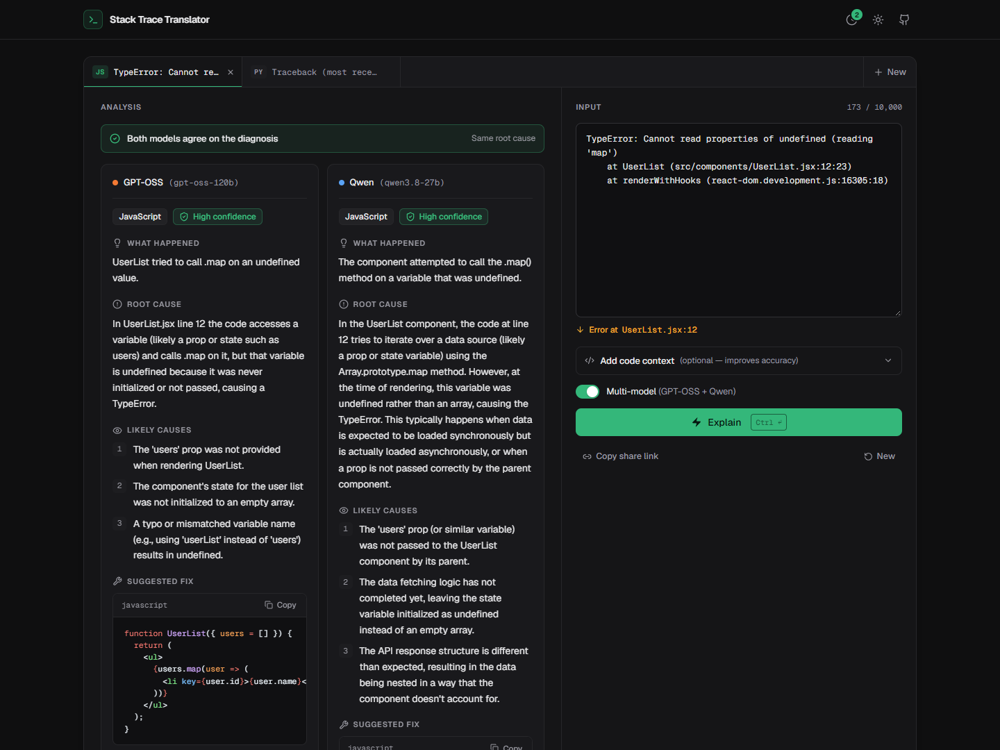

# Stack Trace Translator

[](https://github.com/iGarganis/StackTraceTranslator/actions/workflows/ci.yml)

> Paste a stack trace and get a plain-English explanation: the root cause, likely causes, a suggested fix, the assumptions the model made, and how confident it is. You can also run two different LLMs side by side and see whether they agree.

**Live demo:** [stacktrace.garganis.dev](https://stacktrace.garganis.dev)



---

## Why I built this

Stack Trace Translator started as a question: *how reliable is an LLM when it's giving you debugging advice?*

Any LLM can produce a confident-sounding answer, but confidence and correctness are not the same thing. When I'm debugging, I don't just want an answer. I want to know how sure the model is, what it's assuming about code it can't see, and whether a second model reaches the same diagnosis.

The project explores three patterns for building more trustworthy LLM-powered tools:

1. **Confidence scoring:** the model rates its own certainty against explicit criteria.
2. **Assumption surfacing:** the model must list every inference it made about code that isn't in the trace.
3. **Multi-model verification:** two models from different vendors analyze the same trace in parallel, and disagreements are flagged.

---

## Features

**Analysis**
- **Structured output:** language detection, a plain-English summary, the root cause, likely causes and a syntax-highlighted fix. Every response is validated with Zod before it reaches the UI.
- **Confidence badge:** high, medium or low, based on how much the trace actually reveals.
- **Assumptions:** a collapsible list of what the model inferred but couldn't see.
- **Multi-model mode:** GPT-OSS 120B and Qwen 3.8 27B run in parallel, with an agree/disagree banner. If one model fails, the app falls back to the other and says so.
- **Optional code context:** paste the surrounding function or file to improve accuracy.
- **Explain simply:** rephrases the analysis without jargon, for beginners.
- **Try again:** re-runs the analysis at a higher temperature for a different take.
- **Error location:** points to the failing file and line (e.g. `UserList.jsx:12`) in Python, JS/TS, Java, Kotlin, C#, Go, Rust, Ruby and PHP traces. Frames from dependencies such as `node_modules` or `react-dom` are skipped. Clicking it highlights that frame in the input.

**Workflow**
- **Session tabs:** every analysis opens as a tab you can switch between or close.
- **Local history:** the last 20 analyses are stored in `localStorage`. Nothing is saved on a server.
- **Shareable links:** the input is encoded in the URL hash, so anyone with the link gets the same prefilled form.
- **Copy as Markdown:** exports the full analysis as a GitHub-ready block.
- **Command palette:** `Ctrl/⌘ K`, with keyboard navigation.
- **Keyboard shortcuts:** `Ctrl/⌘ ↵` submits from the input.
- **Dark and light themes:** dark by default.

Works with traces from Python, JavaScript, TypeScript, Java, C#, Go, Rust, Ruby and PHP.

---

## Tech stack

| Technology | Why |
|---|---|
| **Next.js 15 (App Router)** | API routes keep every LLM call on the server, so the API key never reaches the browser. |
| **TypeScript** | Types flow from the Zod-validated LLM response all the way to the React props that render it. |
| **Tailwind CSS + shadcn/ui** | Utility-first styling on top of accessible Radix primitives, themed through CSS variables. |
| **Groq** | Very fast inference. Both models run on Groq through one SDK and one API key. |
| **Zod** | Runtime validation of LLM output. Models sometimes return malformed JSON or drop a field. Zod catches it, the request is retried once, and bad data never reaches the UI. |
| **Shiki** | Syntax highlighting with the same grammar engine as VS Code, in matching light and dark themes. |
| **next-themes** | Dark/light mode without a flash on load. |
| **lucide-react** | A consistent, lightweight icon set. |

---

## AI reliability

### Confidence scoring

LLMs don't have calibrated uncertainty by default. Ask them anything and they answer in the same confident prose, whether or not they have enough information.

The system prompt asks the model to rate its confidence against specific criteria:

- **High:** the trace clearly identifies the error location and the error type is well understood.
- **Medium:** the error type is clear, but the root cause depends on assumptions about unseen code.
- **Low:** the trace is short, truncated, from a niche framework, or the error message is ambiguous.

When a trace is ambiguous, the badge turns amber or red, which tells you to verify the suggestion yourself.

### Assumption surfacing

The most dangerous LLM output is a confident wrong answer, and that confidence usually rests on unstated guesses about your ORM, framework version or data shape.

The model must list *every* non-obvious inference in an `assumptions` array, shown in a collapsible section under the fix. If it assumed SQLAlchemy and you use raw SQL, you can see that and adjust the fix.

### Multi-model verification

No single model is always right. Multi-model mode sends the same trace to two models from different vendors (OpenAI's GPT-OSS and Alibaba's Qwen), which were trained on different data. When both reach the same diagnosis, that is a stronger signal than either one alone.

When they disagree, both answers are shown side by side under an amber "Models disagree" banner, instead of the app silently picking one.

---

## Local setup

### Prerequisites

- Node.js 20+
- A free [Groq API key](https://console.groq.com)

### Steps

```bash
# 1. Clone the repository
git clone https://github.com/iGarganis/StackTraceTranslator.git
cd StackTraceTranslator

# 2. Install dependencies
npm install

# 3. Add your API key
cp .env.local.example .env.local
# then set GROQ_API_KEY in .env.local

# 4. Start the development server
npm run dev
```

Then open [http://localhost:3000](http://localhost:3000).

To get a Groq key, sign up at [console.groq.com](https://console.groq.com), open **API Keys** and create one. The free tier is enough to run the project.

### Checks

```bash
npm test            # unit tests (Vitest)
npm run lint        # ESLint
npm run typecheck   # TypeScript
npm run build       # production build
```

The same four checks run in GitHub Actions on every push and pull request. The tests cover error-location parsing across languages, the LLM output schema, the model agreement heuristic and history migration.

### Deployment

The app deploys to Vercel with no extra configuration. Set `GROQ_API_KEY` in the project's environment variables. Link previews use the project's production domain automatically, including a custom domain. Set `NEXT_PUBLIC_SITE_URL` (e.g. `https://example.com`) only to override it.

---

## Architecture

```
Browser
  │
  │  POST /api/explain
  │  { stackTrace, codeContext?, useMultiModel, temperature? }
  ▼
Next.js API route (server-side only, the key never leaves the server)
  │
  ├── Rate limiter (20 requests / IP / 24h, in memory)
  ├── Input validation (Zod, 10–10,000 characters)
  │
  ├── single ──► analyzeTrace("primary") ──► Zod validate (1 retry if malformed) ──► JSON response
  │
  └── multi ───► Promise.allSettled([
                   analyzeTrace("primary"),     // openai/gpt-oss-120b
                   analyzeTrace("secondary")    // qwen/qwen3.8-27b
                 ])
                 ├── both succeeded → checkAgreement() → { results, agreement }
                 └── one failed     → the other result + fallback notice

POST /api/simplify → rephrases an analysis in plain language (Explain simply)

Browser (client components)
  ├── useHistory()  → localStorage (last 20 analyses)
  ├── useShare()    → URL hash (#data=base64)
  └── useShiki()    → highlighter singleton, loaded once
```

---

## Project structure

```
├── .github/workflows/ci.yml    # Lint, typecheck, test and build on every push
├── app/
│   ├── api/explain/route.ts    # Analysis endpoint: validation, rate limiting, LLM calls
│   ├── api/simplify/route.ts   # "Explain simply" endpoint
│   ├── globals.css             # Design tokens (light + dark CSS variables)
│   ├── layout.tsx              # Fonts, theme provider, page metadata
│   ├── opengraph-image.tsx     # Link-preview image, generated at build time
│   ├── icon.svg                # Favicon
│   └── page.tsx                # Entry point
├── components/
│   ├── ui/                     # Primitives: button, badge, dialog, textarea, kbd, collapsible
│   ├── main-app.tsx            # Root client component that holds the shared state
│   ├── input-panel.tsx         # Trace input, code context, multi-model switch
│   ├── output-panel.tsx        # Empty / loading / error / result states
│   ├── result-card.tsx         # One model's analysis
│   ├── session-tabs.tsx        # Tab bar of past analyses
│   ├── history-panel.tsx       # History dialog
│   ├── command-palette.tsx     # Ctrl/⌘ K palette
│   └── …                       # Header, footer, code block, toasts, empty state
├── hooks/
│   ├── use-history.ts          # localStorage history
│   ├── use-share.ts            # Share-link encode/decode
│   ├── use-shiki.ts            # Highlighter singleton
│   ├── use-toast.ts            # Notifications
│   └── use-typewriter.ts       # Word-by-word reveal for fresh results
├── lib/
│   ├── llm/
│   │   ├── client.ts           # analyzeTrace(), checkAgreement()
│   │   ├── models.ts           # Model IDs and display labels (one place to change them)
│   │   └── schema.ts           # Zod schema: the LLM output contract
│   ├── prompts.ts              # System and user prompts
│   ├── rate-limit.ts           # In-memory rate limiter
│   ├── types.ts                # Shared client types
│   └── utils.ts                # Error-location parsing and display helpers
├── docs/screenshot.png         # README screenshot
├── *.test.ts                   # Unit tests, next to the code they cover
└── .env.local.example          # Environment variable template
```

---

## Future improvements

- **Streaming responses:** stream tokens over SSE instead of waiting for the full JSON.
- **Persistent rate limiting:** replace the in-memory map with Upstash Redis, so limits survive restarts and serverless scaling.
- **Semantic agreement:** compare the two root causes by meaning, not just language and confidence.
- **Diff view:** when the models disagree, highlight where their analyses differ.
- **Server-side history:** optional accounts so history survives clearing the browser.
